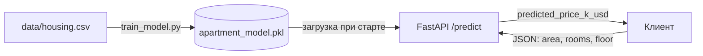

<div align="center">

# 🏠 Apartment Price Prediction API

**REST API, который предсказывает стоимость квартиры по площади, числу комнат и этажу**

[](https://github.com/Gadilova/apartment-price-predictor/actions/workflows/tests.yml)
[](LICENSE)


</div>

## О проекте

Модель машинного обучения (линейная регрессия) обучается на данных о квартирах и сохраняется в файл. FastAPI-сервер загружает её при старте и отвечает на запросы: отправляешь параметры квартиры, получаешь прогноз цены.



## 🚀 Как запустить

```bash
git clone https://github.com/Gadilova/apartment-price-predictor.git
cd apartment-price-predictor
python3 -m venv .venv
.venv/bin/pip install -r requirements.txt   # библиотеки (один раз)
.venv/bin/python model/train_model.py       # обучить модель (один раз)
.venv/bin/uvicorn main:app --reload         # запустить сервер
```

Открой http://localhost:8000/docs — там можно отправить запрос прямо из браузера.

## 🔌 API

| Метод и адрес | Что делает |
|---------------|-----------|
| `GET /` | Приветствие и подсказка |
| `POST /predict` | Прогноз цены квартиры |

**Пример запроса:**

```bash
curl -X POST http://localhost:8000/predict \
  -H "Content-Type: application/json" \
  -d '{"area": 75, "rooms": 3, "floor": 4}'
```

**Ответ:**

```json
{
  "input_features": {"area": 75.0, "rooms": 3, "floor": 4},
  "predicted_price_k_usd": 119.29
}
```

Цена — в тысячах долларов. Неверные данные (площадь ≤ 0, 0 комнат) вернут ошибку `422`. Если модель ещё не обучена — `503`.

## 🧠 Модель

| | |
|---|---|
| Алгоритм | Линейная регрессия (`sklearn.linear_model.LinearRegression`) |
| Признаки | `area` (м²), `rooms`, `floor` |
| Цель | `price` (тыс. $) |
| Данные | [data/housing.csv](data/housing.csv) — 10 учебных примеров |
| Качество | R² = 0.996 на обучающих данных |

> Данных очень мало, поэтому модель учебная: R² на тех же данных, на которых она училась, всегда выглядит лучше, чем на новых. Следующий шаг — больше данных и отдельная тестовая выборка.

## 🧪 Тесты

```bash
.venv/bin/pip install -r requirements-dev.txt
.venv/bin/python -m pytest -v
```

GitHub Actions запускает тесты после каждого push.

## 📁 Структура

```
apartment-price-predictor/
├── main.py              # FastAPI-сервер
├── model/
│   └── train_model.py   # обучение и сохранение модели
├── data/
│   └── housing.csv      # данные для обучения
├── tests/               # автотесты pytest
├── requirements.txt
└── requirements-dev.txt
```

## 🗺️ Планы

- [ ] Больше данных: реальные объявления о продаже
- [ ] Разделить данные на обучающие и тестовые, считать MAE
- [ ] Добавить район и год постройки
- [ ] Сравнить линейную регрессию с Random Forest

---

<div align="center">

Учебный проект · [Aiganym Gadilova](https://github.com/Gadilova) · лицензия [MIT](LICENSE)

</div>
